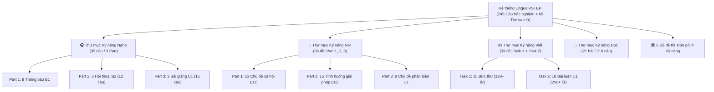

# BÁO CÁO TOÀN DIỆN DỰ ÁN LINGUA VSTEP (BẬC 3–5 · MỤC TIÊU C1)

> **Kính gửi:** Cố vấn học thuật & Người học  
> **Thời điểm cập nhật:** 08/11/2026  
> **Mục tiêu cốt lõi:** Luyện thi chứng chỉ VSTEP Bậc 3–5, hướng tới điểm số **8.5+ (Bậc C1)** cho kỳ thi Chuẩn đầu ra ngày 29/11/2026 tại ĐH Sư phạm – ĐHĐN.  
> **Địa chỉ web trực tuyến (Live):** [https://tiendung04dtvt-debug.github.io/lingua/](https://tiendung04dtvt-debug.github.io/lingua/)  
> **Kho mã nguồn:** [https://github.com/tiendung04dtvt-debug/lingua.git](https://github.com/tiendung04dtvt-debug/lingua.git) (Nhánh `main`)

---

## 1. Bảng số liệu kiểm kê thực tế (9 Gói JSON tự nạp)

Toàn bộ 9 gói dữ liệu đã được nạp trực tiếp qua `AUTO_PACKS` trong `app.js`, đồng bộ vào `localStorage` của trình duyệt:

| Kỹ năng | Số lượng thực tế | Cấu trúc & Nguồn gốc học liệu |
| :--- | :---: | :--- |
| **📖 Kỹ năng Đọc hiểu (Reading)** | **210 câu / 21 bài đọc** | • **B1 (2 bài · 20 câu):** Nắm ý chính, chi tiết trực tiếp. • **B2 (10 bài · 100 câu):** Paraphrase, từ đồng nghĩa, cấu trúc phức. • **C1 (9 bài · 90 câu):** Suy luận trừu tượng, thái độ tác giả, từ vựng học thuật hiếm gặp. *(Trích xuất từ ĐHNN Đà Nẵng 2025, ĐH Cần Thơ 2015, ĐH Quy Nhơn, ZIM, PREP và Lingua C1).* |
| **🎧 Kỹ năng Nghe hiểu (Listening)** | **35 câu / 7 phần** | • **Part 1 (B1 · 8 câu):** 8 thông báo & chỉ dẫn công cộng. • **Part 2 (B2 · 12 câu):** 3 hội thoại thực tế (đăng ký tín chỉ, đàm phán mặt bằng, hợp đồng thuê nhà) có phân vai Nam / Nữ. • **Part 3 (C1 · 15 câu):** 3 bài giảng học thuật (Đảo nhiệt đô thị, Vòng lặp thói quen thần kinh, Thủy lợi Lưỡng Hà cổ đại). *(Đề luyện tập chuẩn cấu trúc VSTEP kèm bản ghi âm TTS Audio `en-GB`, lời thoại Transcript ẩn và giải thích bẫy từ vựng).* |
| **✍️ Kỹ năng Viết (Writing)** | **33 nhiệm vụ** | • **Task 1 (15 đề thư):** 10 dạng thư B1–B2 toàn diện (Phàn nàn dịch vụ, Xin lỗi khách hàng, Hỏi thông tin hội thảo, Thư ứng tuyển, Mời diễn giả, Xin gia hạn nộp dự án, Từ chối lịch sự, Yêu cầu hoàn tiền...) + thư Jane ĐH Cần Thơ & ĐHĐN. • **Task 2 (18 bài luận C1):** Đề luận du lịch cộng đồng ĐH Cần Thơ + 10 chủ đề thực chiến 2026 (AI trong giáo dục, Xã hội không tiền mặt, Cấm đồ nhựa, Áp lực người trẻ, Bảo tồn văn hóa...) kèm dàn ý 4 bước và checklist tiêu chí chấm VSTEP. |
| **🎤 Kỹ năng Nói (Speaking)** | **36 nhiệm vụ** | • **Part 1 (13 chủ đề B1):** Tương tác xã hội phản xạ (Thời tiết, Sở thích, Công nghệ, Đi lại, Mua sắm, Âm nhạc, Lễ hội, Bạn bè, Ngôn ngữ, Giấc ngủ, Free-time activities...). • **Part 2 (15 tình huống B2):** Thảo luận 3 giải pháp, chọn 1 và phản bác 2 phương án còn lại (Chuyến đi Đà Nẵng - Hà Nội, Kỹ năng mềm, Đám cưới, Tiết kiệm năng lượng, Giải quyết mâu thuẫn, Quà tặng văn hóa...). • **Part 3 (8 chủ đề C1):** Phát triển thói quen đọc sách (ĐH Cần Thơ), luận điểm chuyên sâu, sơ đồ mindmap và câu hỏi mở rộng (*follow-up*). |
| **🏛️ Bộ đề thi trọn gói** | **6 bộ đề** | ĐHNN Đà Nẵng 2025, ĐH Cần Thơ 2015, ĐH Quy Nhơn, ĐH Đồng Tháp, ZIM Academy, PrepEdu. |

---

## 2. Danh mục 9 Content Packs đã tích hợp trong hệ thống

1. `packs/vstep-official-sample-udn.json`: Đề mẫu chuẩn hóa do ĐHNN – ĐH Đà Nẵng công bố năm 2025 (40 câu Đọc, 5 nhiệm vụ Viết/Nói).
2. `packs/vstep-ctu-reading.json`: **Đề mẫu chính thức CFLA – Trường Đại học Cần Thơ (Tháng 5/2015)** (40 câu Đọc có bảng đáp án gốc & giải thích chi tiết, 2 bài Viết và 3 phần Nói kèm dàn ý C1).
3. `packs/vstep-official-sample-qnu.json`: Đề mẫu do Trường ĐH Quy Nhơn công bố (40 câu Đọc, 5 nhiệm vụ Viết/Nói).
4. `packs/vstep-sample-zim.json`: Bài mẫu luyện thi mô phỏng từ Học viện Anh ngữ ZIM (40 câu Đọc, 5 nhiệm vụ Viết/Nói).
5. `packs/vstep-sample-prep.json`: Bài mẫu luyện thi chuẩn hóa từ PrepEdu (40 câu Đọc, 5 nhiệm vụ Viết/Nói).
6. `packs/vstep-hot-topics-c1.json`: Gói luyện C1 tổng hợp (10 câu Đọc, 16 nhiệm vụ Viết/Nói).
7. `packs/vstep-listening-full.json`: **Trọn bộ 35 câu hỏi Nghe 3 phần chuẩn Quốc gia (TTS Audio / Simulated)** có Audio giọng chuẩn và Transcript chi tiết.
8. `packs/vstep-writing-task1-expanded.json`: **10 Đề viết thư Task 1 toàn diện (Simulated)**, bao quát 10 dạng tình huống công vụ & đời sống.
9. `packs/vstep-speaking-expanded.json`: **18 Đề thi Nói mở rộng (Simulated)** (10 chủ đề Part 1 + 8 tình huống biện hộ giải pháp Part 2).

---

## 3. Các nâng cấp kỹ thuật nổi bật trên giao diện (Frontend v7)

- **Phân tách Tab thư mục độc lập:** Giao diện `Luyện tập` phân chia rõ ràng 5 tab chuyên biệt:
  - `[📂 Tất cả]`
  - `[🎧 Kỹ năng Nghe (35 câu)]`
  - `[🎤 Kỹ năng Nói (36 đề)]`
  - `[✍️ Kỹ năng Viết (33 đề)]`
  - `[📖 Kỹ năng Đọc hiểu (21 bài · 210 câu)]`
  - `[🏛️ Đề thi trọn bộ (6 bộ)]`
- **Bộ lọc 3 cấp độ:** Dễ dàng lọc nhanh theo từng bậc mục tiêu: `B1 (Nền tảng)`, `B2 (Trung cấp)`, `C1 (Mục tiêu C1)`.
- **Audio Player & Speech Synthesis:** Tích hợp bộ phát âm giọng chuẩn Anh - Anh (`en-GB`), có điều chỉnh cao độ phân vai Nam/Nữ cho các bài hội thoại Part 2.
- **Transcript thông minh:** Trong lúc làm bài Nghe, transcript được thu gọn trong thẻ `
` để học viên tự thử thách khả năng nghe; sau khi trả lời có thể mở ra để đối chiếu bẫy từ vựng và câu hỏi suy luận.
- **Workspace phòng thi cho Writing & Speaking:** Bộ đếm từ tự động chuyển trạng thái xanh khi đạt mốc tối thiểu (120 từ cho Task 1, 250 từ cho Task 2), tích hợp sẵn khung dàn ý gợi ý 1-click và checklist tự rà soát theo rubric chấm thi VSTEP.
- **Bảo mật & Offline-first:** Lưu trữ tiến độ và bài làm nháp 100% cục bộ trên `localStorage`, không gửi dữ liệu ra bên ngoài, có nút xuất dự phòng `lingua-progress.json`.
- **Chống lưu đệm (Cache-busting v7):** Đã cập nhật version query `v=20261108-v7` trên tất cả tài nguyên tĩnh để trình duyệt luôn tải bản cập nhật mới nhất.
