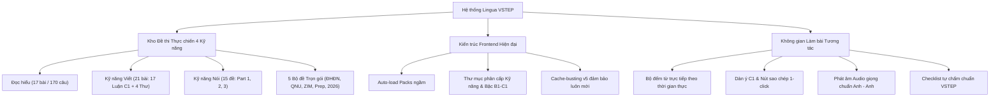

# BÁO CÁO TỔNG QUAN DỰ ÁN LINGUA — NỀN TẢNG LUYỆN THI VSTEP BẬC 3–5 (MỤC TIÊU C1)

> **Kính gửi:** Cố vấn Gemini  
> **Người thực hiện:** Học viên dự án Lingua  
> **Ngày báo cáo:** 08/11/2026  
> **Mục tiêu cốt lõi:** Luyện thi chứng chỉ VSTEP Bậc 3–5, tập trung cao độ vào **Mục tiêu đạt Bậc C1** cho kỳ thi Chuẩn đầu ra sắp tới (ngày 29/11/2026 tại ĐH Sư phạm – ĐHĐN).  
> **Địa chỉ web trực tuyến (Live):** [https://tiendung04dtvt-debug.github.io/lingua/](https://tiendung04dtvt-debug.github.io/lingua/)  
> **Kho mã nguồn (GitHub):** [https://github.com/tiendung04dtvt-debug/lingua.git](https://github.com/tiendung04dtvt-debug/lingua.git) (Nhánh `main`)

---

## I. TỔNG QUAN CÁC KẾT QUẢ ĐÃ ĐẠT ĐƯỢC

Dự án đã phát triển từ một trang web demo ngữ pháp ban đầu thành một **Hệ sinh thái luyện thi VSTEP hoàn chỉnh, tự vận hành (Serverless & Offline-first)** với dữ liệu 100% là đề thi mẫu chính thức và đề thi chuẩn thực chiến, nói **KHÔNG** với câu hỏi tự biên bịa đặt kém chất lượng.

### Bảng số liệu tổng hợp dữ liệu học tập

| Hạng mục | Số lượng | Chi tiết nguồn & Định dạng |
| :--- | :---: | :--- |
| **Câu hỏi Đọc hiểu (Reading)** | **170 câu** | 17 bài đọc tiêu chuẩn VSTEP Bậc 3–5 (10 câu/bài), có đáp án và giải thích tiếng Việt. |
| **Bài viết luận Task 2 (Writing)** | **17 đề** | Gồm **10 đề luận thi thật mới nhất 2026** (AI giáo dục, Tiền mặt, Rác nhựa...) kèm dàn ý & từ vựng C1. |
| **Bài viết thư Task 1 (Writing)** | **4 đề** | Đủ thể loại: Thư thân mật (B1), Thư công việc, tư vấn tour & thư giới thiệu du học (B2). |
| **Chủ đề Nói Part 3 (Speaking C1)** | **7 đề** | Phát triển chủ đề học thuật, mindmap luận điểm và bộ câu hỏi phản biện mở rộng (follow-up). |
| **Chủ đề Nói Part 2 (Speaking B2)** | **6 đề** | Thảo luận và bảo vệ giải pháp (chọn 1 trong 3 phương án và phản bác 2 phương án còn lại). |
| **Chủ đề Nói Part 1 (Speaking B1)** | **2 đề** | Tương tác xã hội phản xạ nhanh (Hometown, Daily routine, Food, Books...). |
| **Bộ đề thi trọn gói 4 kỹ năng** | **5 bộ đề** | ĐH Ngoại ngữ Đà Nẵng 2025, ĐH Quy Nhơn, ĐH Đồng Tháp, ZIM Academy, PrepEdu. |

---

## II. CHI TIẾT DỮ LIỆU ĐỀ THẬT THEO TỪNG THƯ MỤC

Hệ sinh thái học liệu đã được phân loại theo cấu trúc cây thư mục rành mạch:

### 1. Thư mục: ✍️ Kỹ năng Viết (Writing — 21 đề)
* **Viết Bậc C1 (Task 2 — 17 đề bài luận chuyên sâu):**
  * *10 Đề thi thật 2026:* Trí tuệ nhân tạo (AI) trong giáo dục, Xã hội không dùng tiền mặt, Cấm đồ nhựa dùng một lần, Áp lực tâm lý của người trẻ hiện đại, Mua sắm online vs cửa hàng truyền thống, Làm việc từ xa và mô hình kết hợp, Miễn phí giao thông công cộng, Đại học truyền thống vs Học nghề ngắn hạn, Bảo tồn văn hóa thời toàn cầu hóa, Trách nhiệm đầu tư năng lượng tái tạo.
  * *Các đề thi chuẩn mực:* Đô thị hóa & quá tải dân số (ZIM), Cơ hội và thách thức của toàn cầu hóa (PrepEdu), Trách nhiệm bảo vệ môi trường (ĐHĐN 2025).
  * *Tính năng:* Mỗi đề đều tích hợp sẵn **Dàn ý lập luận C1** (Mở bài, Thân bài ủng hộ, Phản biện & Bác bỏ, Kết bài) và từ vựng học thuật.
* **Viết Bậc B2 (Task 1 — 2 đề thư công việc):**
  * Thư tư vấn khách sạn, điểm tham quan và thực đơn chay cho Richard (ĐH Quy Nhơn).
  * Thư gửi gia đình Jane giới thiệu về tính cách và sở thích của bạn An đi du học London (ĐHĐN 2025).
* **Viết Bậc B1 (Task 1 — 2 đề thư thân mật):**
  * Thư phản hồi cho Alex về trải nghiệm cắm trại tại đảo Cát Bà (ZIM Academy).
  * Thư phản hồi cho đồng nghiệp Michael về bài học từ hội thảo công nghệ AI tại Singapore (PrepEdu).

### 2. Thư mục: 🎤 Kỹ năng Nói (Speaking — 15 đề)
* **Nói Bậc C1 (Part 3: Phát triển chủ đề & Phản biện — 7 đề):**
  * Tầm quan trọng của thể dục thể thao đối với thanh thiếu niên (Physical exercise for teenagers).
  * Tác động của mạng xã hội đối với đời sống hiện đại (Impact of social media).
  * Hoạt động đọc sách trong kỷ nguyên số (ĐHĐN 2025).
  * Thách thức cân bằng giữa bảo tồn di sản và hiện đại hóa (C1 Hot Topics).
  * Du lịch sinh thái và phát triển kinh tế địa phương (ĐH Quy Nhơn).
  * *Tính năng:* Mindmap 3 nhánh ý tưởng + 1 nhánh tự phát triển, kèm 3 câu hỏi phụ (follow-up) phản biện và nút nghe đọc đề.
* **Nói Bậc B2 (Part 2: Thảo luận & Biện hộ giải pháp — 6 đề):**
  * Chọn hoạt động team-building (Thi nấu ăn vs Ngày hội thể thao vs Đố vui kiến thức).
  * Chọn chiến lược phục hồi doanh số hiệu sách sinh viên (Giảm giá vs CLB sách vs Mở bán cafe).
  * Chọn phương tiện đi du lịch tập thể (ĐHĐN 2025).
  * Chọn quà lưu niệm chia tay đồng nghiệp (ĐH Quy Nhơn).
* **Nói Bậc B1 (Part 1: Tương tác xã hội — 2 đề):**
  * Lịch trình hàng ngày (Daily Routine) & Ẩm thực (Food preferences).
  * Quê hương (Hometown) & Thói quen đọc sách (Reading books).

### 3. Thư mục: 📖 Kỹ năng Đọc hiểu (Reading — 17 bài · 170 câu hỏi)
* **Đọc Bậc C1 (7 bài · 70 câu):** Bài 4 ĐHĐN (Thế giới RNA & Vi khuẩn cổ), Bài 4 ZIM (Nguồn gốc ngôn ngữ), Bài 4 Prep (Bí ẩn tượng Moai đảo Phục Sinh), Bài 4 QNU (Địa chất kiến tạo), Bài 3 ĐHĐN (Băng tan Greenland), Bài 3 QNU (Thanh tra Pelham).
* **Đọc Bậc B2 (8 bài · 80 câu):** Rạn san hô, Rác thải điện tử E-waste, Thực hành chánh niệm, Văn hóa duyên hải Bắc Thái Bình Dương, Bức thư bí ẩn của ông Smith, Xung đột quốc tế, Bí mật 4 ngành nghề, Thị trường căn hộ Manhattan.
* **Đọc Bậc B1 (2 bài · 20 câu):** Mô hình làm việc từ xa (Remote work), Làm việc trong môi trường khắc nghiệt.

### 4. Thư mục: 🏛️ 5 Bộ đề trọn gói (Full Mock Tests)
* ĐH Ngoại ngữ Đà Nẵng 2025 (chuẩn 4 kỹ năng có audio).
* ĐH Quy Nhơn & ĐH Đồng Tháp (chuẩn 4 kỹ năng).
* ZIM Academy VSTEP Full Test.
* PrepEdu VSTEP Full Test.
* VSTEP C1 Hot Topics & 10 Bài luận thi thật 2026.

---

## III. NÂNG CẤP KIẾN TRÚC KỸ THUẬT & TRẢI NGHIỆM HỌC VIÊN

### 1. Kiến trúc Frontend & Lưu trữ
* **Serverless & Offline-Ready:** Chạy hoàn toàn trên trình duyệt, không cần backend server, nạp dữ liệu qua chuẩn JSON Schema `1.1.0`. Toàn bộ bài làm của học viên được lưu bền vững trên `localStorage` và có thể xuất ra file dự phòng `lingua-progress.json`.
* **Cơ chế Tự động nạp (`autoLoadPacks`):** Hệ thống ngầm nạp toàn bộ 5 bộ đề ngay khi mở trang, người học không phải tự bấm nạp thủ công.
* **Cơ chế Chống lưu Cache (`Cache-Busting v5`):** Gắn version query string (`?v=20261108-v5`) trên `styles.css` và `app.js` để người học luôn được cập nhật bản mới nhất ngay khi truy cập.

### 2. Giao diện Đọc hiểu & Typography
* **Tối ưu cỡ chữ và tương phản:** Tăng font chữ bài đọc lên `15.5px`, giãn dòng `1.85`, màu chữ đen sẫm `#1e293b` trên nền thẻ trắng sắc nét.
* **Khung bài đọc nổi bật:** Sử dụng thẻ `.stimulus` viền trái dày 5px màu xanh ngọc thương hiệu, giúp người đọc dễ định vị văn bản trong khi trả lời câu hỏi.
* **Huy hiệu trực quan:** Phân định rõ màu sắc theo bậc:
  * `🟣 Bậc C1`: Tím hoàng gia sang trọng.
  * `🔵 Bậc B2`: Xanh dương năng động.
  * `🟢 Bậc B1`: Xanh ngọc vững chắc.
  * `🟠 Đề mẫu chính thức`: Cam đất trang trọng.

### 3. Không gian Làm bài Viết & Nói tương tác (Task Workspace)
* Thay thế ô nhập thô sơ cũ bằng không gian làm bài chuyên nghiệp:
  * Khung đề bài kèm yêu cầu dung lượng từ và thời gian khuyến nghị.
  * Nút **🔊 Nghe phát âm đề bài** bằng giọng đọc chuẩn bản xứ Anh - Anh.
  * Khung **💡 Dàn ý gợi ý chuẩn C1** có cấu trúc phân tầng rõ ràng kèm nút **📋 Sao chép dàn ý vào bài làm**.
  * Khung soạn thảo với **Bộ đếm từ trực tiếp (Live Word Counter)** tự động đổi sang màu xanh lục khi người học viết đủ số từ quy định (120 từ / 250 từ).
  * **Checklist tự chấm điểm**: Học viên tích chọn các tiêu chí chấm thi của VSTEP (Task fulfillment, Lexical resource, Coherence, Grammar).
  * Nút **💾 Lưu bài làm trên thiết bị** để bảo toàn sản phẩm luyện tập.

---

## IV. QUẢN LÝ TÀI NGUYÊN & AN TOÀN BẢN QUYỀN

1. **Phân tách tài liệu nội bộ & công khai:**
   * Các tệp PDF đề mẫu và file âm thanh gốc được giữ an toàn tại `packs/private/reference-materials/` và loại khỏi Git bằng `.gitignore` để tuân thủ quyền sở hữu tài liệu.
   * Dữ liệu đưa lên ứng dụng được chuẩn hóa thành định dạng JSON mở phục vụ mục đích học tập phi thương mại.
2. **Sổ đăng ký học liệu (`CONTENT_REGISTER.md`):**
   * Theo dõi minh bạch xuất xứ từng nguồn tài liệu, hàm băm SHA-256 để chống trùng lặp dữ liệu (ví dụ: đã phát hiện đề ĐH Đồng Tháp trùng hoàn toàn với ĐH Quy Nhơn và chỉ tính là 1 đề).

---

## V. ĐỊNH HƯỚNG BƯỚC TIẾP THEO

1. **Rèn luyện chuyên sâu 10 Bài luận C1:** Tận dụng 10 chủ đề thi thật 2026 đã nạp sẵn để viết bài hàng ngày, sử dụng từ vựng nâng cao và câu phức.
2. **Luyện phản xạ Nói Part 3:** Thu âm trực tiếp theo thời gian thực (5 phút/bài) dựa trên 7 chủ đề C1 đã tích hợp.
3. **Thi thử bài đọc bấm giờ:** Thực hiện làm liên tục 4 bài đọc (40 câu / 60 phút) trên giao diện Lingua để rèn tốc độ làm bài trước ngày thi 29/11/2026.

---

*Báo cáo được khởi tạo tự động từ hệ thống mã nguồn Lingua.*  
*Tài liệu đính kèm: `CONTENT_REGISTER.md`, `app.js`, `styles.css`, và 5 bộ đề JSON trong thư mục `packs/`.*
